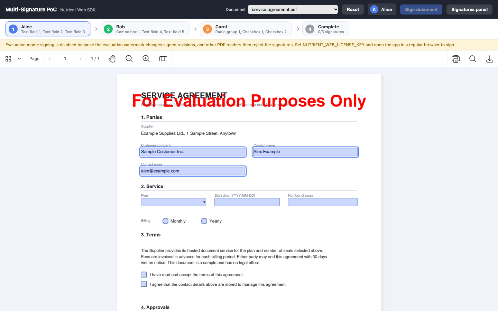
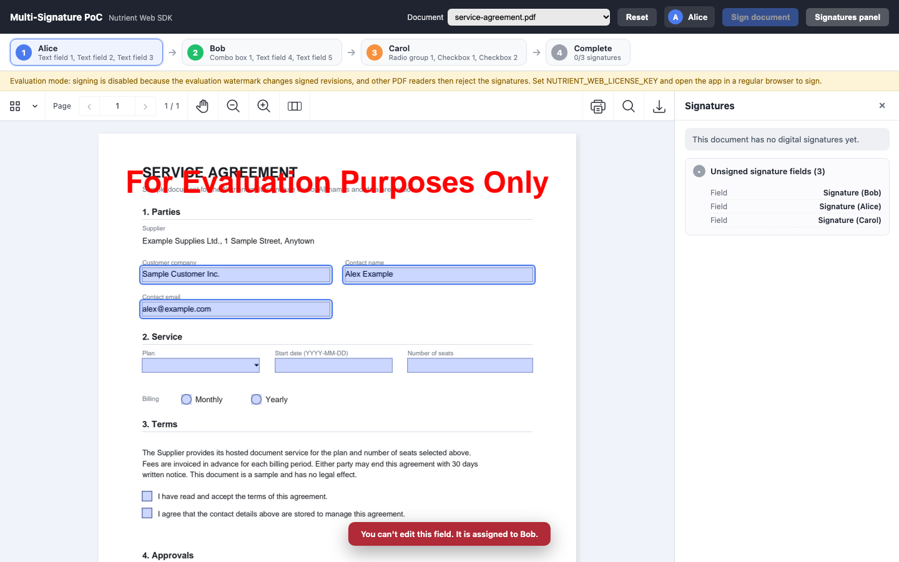

# Nutrient Multi-Signature Workflow

A Nutrient.io demo in which three people fill in their own part of a PDF form and sign it one after the other with certificate-based digital signatures, each signature keeping the previous ones valid.



1. **Documents.** At start-up, the server copies each PDF of `input-docs/` to `storage/`. On the way it removes structure tagging, merges form fields that have a single widget into that widget, and adds one signature field per signer (`Signature-alice`, `Signature-bob`, `Signature-carol`) if the form has none.
2. **Viewer.** The Nutrient Web SDK opens the PDF in the browser (WebAssembly). The app splits the fillable fields evenly between Alice, Bob and Carol in reading order and highlights the fields of the person whose turn it is. Fields and signature fields of other people are blocked.
3. **Fill.** Before signing, the filled form is exported and saved on the server as a normal incremental update.
4. **Sign.** `instance.signDocument()` creates a CAdES signature in the signer's field. The Web SDK computes the data to be signed and the app sends it to `POST /api/users/:id/sign`. The server signs it with that person's private key (RSA, SHA-256), so private keys never reach the browser. The signature carries the signer certificate and the demo CA certificate.
5. **Save and verify.** The signed PDF is sent back to the server. The server keeps the previous version in `storage/history/`, checks the byte range and the SHA-256 digest of every signature in the file, and refuses the save if one of them does not match.
6. **Validation.** The viewer validates the signatures against the demo CA (`trustedCAsCallback`), and the signatures panel lists every revision with its signer, reason, location, integrity and certificate chain status.

Everything runs on the Nutrient Web SDK and a small Node.js server (Express). Certificates are created locally with OpenSSL.

## Prerequisites

- Node.js 20.12 or later and npm
- OpenSSL, to generate the demo certificates
- A Nutrient Web SDK license key to sign documents (see below)

## Environment variables

Copy `.env.example` to `.env`. The server reads it at start-up. The license key is only read from the environment, never from code.

| Variable | Purpose | Default |
|---|---|---|
| `PORT` | HTTP port of the demo | `4870` |
| `NUTRIENT_WEB_LICENSE_KEY` | Nutrient Web SDK license key, served to the browser by `GET /api/config` | empty = evaluation mode |

In evaluation mode, documents open and forms can be filled, but the **Sign document** button is disabled: the evaluation watermark changes each signed revision, and other PDF readers then reject the signatures. Ask Nutrient for an evaluation license key to try the full workflow. The app also falls back to evaluation mode in an embedded Electron browser, where a Web SDK license for regular browsers does not apply.

`scripts/generate-certs.sh` writes the demo certificates to `certs/`, which is not committed:

| File | Content |
|---|---|
| `certs/ca.key`, `certs/ca.crt` | Demo root CA, valid 10 years |
| `certs/alice.key`, `certs/alice.crt` (and `bob`, `carol`) | RSA 2048 key and certificate of each signer, issued by the demo CA, valid 5 years |
| `certs/trusted/demo-ca.pem` | The CA certificate the viewer trusts when it validates signatures |

## Build and run

```bash
npm install
```

```bash
npm run generate-certs
```

```bash
cp .env.example .env
```

```bash
npm start
```

Open <http://localhost:4870>.

The two sample documents in `input-docs/` are generated by `scripts/generate-samples.mjs` with pdf-lib. All names and data in them are fictitious:

- `service-agreement.pdf`: a one-page service agreement with text fields, a dropdown, a radio group, two check boxes and three signature fields
- `service-agreement-with-attachments.pdf`: the same form with two embedded files, a price list (CSV) and a service description (TXT)

To regenerate them:

```bash
npm run generate-samples
```

To use your own PDF, copy it to `input-docs/` and restart the server. `storage/` holds the working copies and their history and is not committed. Delete it to start again from `input-docs/`.

## Using the app

1. Choose a document in the **Document** list. The stepper shows, for each person, the fields they have to fill. It is Alice's turn first.
2. Fill in the highlighted fields. Clicking a field that belongs to someone else shows who it is assigned to.

   

3. Click **Sign document** or the highlighted signature field. Check the field, reason and location, then click **Sign and save**. The app saves the filled form, signs, saves the signed PDF, reloads it from the server and opens the signatures panel.
4. The next person's turn starts. Repeat for Bob, then Carol. After the third signature the stepper shows **Complete**.
5. **Signatures panel** lists each signature with its status, signing time, reason, location, document integrity and certificate chain, and the signature fields that are still empty.
6. **Reset** restores the original file from `input-docs/` and restarts the workflow.

Use the download button of the viewer toolbar to save the signed PDF and open it in another PDF reader. To have the signatures shown as trusted there, trust `certs/ca.crt` in that reader.

## API

| Method and path | Description |
|---|---|
| `GET /api/config` | `{ licenseKey }` for the Web SDK, `null` in evaluation mode |
| `GET /api/users` | `[{ id, name }]`: Alice, Bob and Carol, in signing order |
| `GET /api/users/:id/certificates` | `{ name, certificate, caCertificate }` in PEM |
| `POST /api/users/:id/sign` | `application/octet-stream` body with the data to be signed. Returns `{ signature }`, an RSA SHA-256 signature in base64 |
| `GET /api/trusted-cas` | PEM certificates of `certs/trusted/` |
| `GET /api/documents` | `[{ id, name, size, modified, versions }]` of `storage/` |
| `GET /api/documents/:id/file` | The current PDF |
| `POST /api/documents/:id/file` | `application/pdf` body. Stores the previous version in `storage/history/`, verifies every signature and saves. Returns `{ ok, size, repaired, verification }`, or `422` if a signature does not verify |
| `POST /api/documents/:id/reset` | Restores the document from `input-docs/` |

## Files

| Path | Content |
|---|---|
| `server.js` | Express server: documents, signing service, save checks |
| `public/` | The web page: Web SDK viewer, stepper, field guards, signatures panel |
| `scripts/generate-certs.sh` | Demo CA and signer certificates in `certs/` |
| `scripts/generate-samples.mjs` | Sample PDFs in `input-docs/` |
| `input-docs/` | Original documents, copied to `storage/` at start-up |

The server serves the Web SDK from the `@nutrient-sdk/viewer` npm package (`/vendor/nutrient`).
